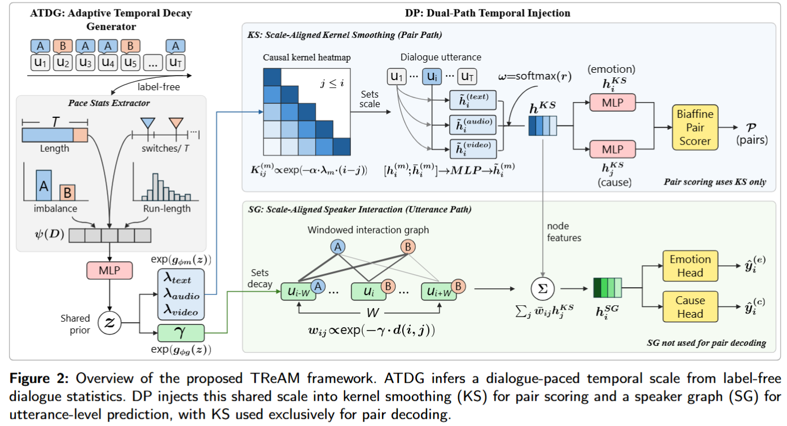

Code is being released continuously.

# TReAM: Temporal Recency Alignment Across Modules for Multimodal Emotion-Cause Pair Extraction

This repository contains the core implementation of our paper:

**Temporal Recency Alignment Across Modules for Multimodal Emotion–Cause Pair Extraction**

TReAM is a lightweight framework for **Multimodal Emotion-Cause Pair Extraction (MECPE)**. It coordinates temporal priors across global pair reasoning and local speaker interaction through a shared dialogue-conditioned latent factor and module-specific decay rates.

## Framework

An overview of the proposed TReAM framework is provided in the figure below:



## Overview

Multimodal Emotion-Cause Pair Extraction aims to identify emotion utterances, cause utterances, and structured emotion-cause links in multi-speaker multimodal dialogues.

Existing modular MECPE models often combine sequential aggregation and speaker-interaction modules. However, these modules may encode different temporal recency assumptions, resulting in cross-module temporal misalignment and unstable pair prediction.

TReAM addresses this issue through two key components:

- **ATDG: Adaptive Temporal Decay Generator**  
  Maps label-free dialogue statistics such as dialogue length, speaker distribution, speaker-switching rate, and turn-taking patterns to a shared latent factor, then generates positive module-specific decay rates.

- **DP: Dual-Path Temporal Injection**  
  Injects the dialogue-conditioned decay rates into:
  - **Kernel Smoothing (KS)** for global, order-respecting pair reasoning.
  - **Speaker Graph (SG)** for local speaker-aware utterance-level prediction.

Pair scoring uses KS representations. SG takes KS representations as node features and supports utterance-level emotion and cause prediction. The heads share upstream representations and temporal conditioning.

## Main Features

- Dialogue-adaptive temporal recency modeling
- Cross-module temporal alignment between sequential aggregation and speaker interaction
- Dual-path design separating pair-level reasoning and utterance-level prediction
- Support for text-only and multimodal settings
- Experiments on ECF and MECAD datasets
- Robust performance on sparse and non-local emotion-cause links

## Method

TReAM consists of three main stages:

1. **Multimodal Utterance Encoding**  
   Each utterance is represented using text, audio, and video features.

2. **Adaptive Temporal Scale Generation**  
   ATDG maps label-free dialogue statistics to a shared latent temporal factor, which is then used to generate temporal decay parameters.

3. **Dual-Path Reasoning**
   - **KS Path:** Performs temporally aligned global aggregation and serves as the only input to the pair scorer.
   - **SG Path:** Performs local cross-speaker interaction and supports utterance-level emotion and cause classification.

## Results

On the ECF dataset, TReAM achieves strong performance in the full multimodal setting:

| Task | F1 |
|---|---:|
| Emotion Extraction | 79.33 |
| Cause Extraction | 73.26 |
| Pair Extraction | 57.92 |

On the MECAD dataset, TReAM also improves pair extraction performance and achieves a Pair F1 of 52.21 in the full multimodal setting.

## Repository Structure

The current release contains the core method modules:

```text
TReAM/
├── tream/
│   ├── __init__.py        # Core module exports
│   ├── encoders.py        # Text utterance encoding and audio/video projections
│   ├── atdg.py            # Dialogue pace statistics and shared-latent decay generation
│   ├── layers.py          # Packed sequence encoding and biaffine scoring
│   ├── temporal.py        # Kernel smoothing and local speaker graph
│   ├── model.py           # Core model, modality fusion, and prediction heads
│   ├── objectives.py      # Valid-pair target construction and joint extraction loss
│   └── decoding.py        # Distance prior and auxiliary-gated pair decoding
├── figures/
│   └── framework.png      # Framework overview
└── README.md
```

The core modules use PyTorch and Transformers. `TReAMModel` combines text utterance encoding, cached acoustic/visual feature projections, dual-path reasoning, and the joint extraction objective. `TReAM` exposes the reasoning network over utterance-level features.

Text encoding uses a supplied pretrained backbone and utterance spans within packed token sequences. The paper uses RoBERTa-base for ECF and hfl/chinese-roberta-wwm-ext for MECAD. Audio and video inputs are pre-extracted utterance features.

The model returns emotion, cause, and pair logits together with padding and temporal-precedence masks. Pair tensors use the axis order `(batch, emotion turn, cause turn, class)` with valid causes satisfying `j <= i`. The joint objective applies pair supervision to KS representations and utterance-level supervision to SG representations.

Decoding combines the training-distance prior with non-neutral emotion and cause probabilities. Thresholds and the distance-prior weight are supplied as fixed validation-selected values.
